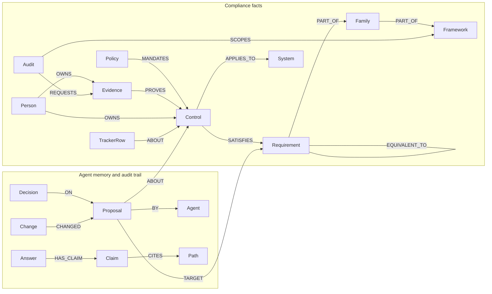

# Crosswalk: audit-prep AI agents on a Relate compliance graph (NIST, MCP)

**An audit-prep agent that answers with receipts.** Every claim is a path in the graph, from requirement to control to evidence, and Crosswalk re-checks that path before you read the answer.

*Prove a control once, satisfy every framework, and see what breaks before the auditor does.*

Keywords: Relate, compliance, NIST 800-53, NIST 800-171, NIST CSF 2.0, AI agent, MCP, graph, hybrid search.

| | |
|---|---|
| Demo video (1:50, no login) | <!-- VIDEO_LINK --> link coming |
| Browser explorer (no install, no server, no AI key) | **https://amanpundhir.github.io/crosswalk-relate/** (or locally: `python -m http.server -d web 8000`) |
| Source | Public GitHub repository, link coming (topics `relate`, `relate-neo4j-hackathon`) |

*Built for the Relate by Neo4j Hackathon ("Context, connected"), Nov 11 to Dec 11, 2026. The company in the demo, Harbor & Pine, is fictional. This is not audit advice.*

## Headline results

From [`eval/scorecard.md`](eval/scorecard.md) (generated by `crosswalk scorecard`; agent numbers come from recorded runs, everything else is computed from the committed store with no AI call).

| Metric | Result | Note |
|---|---|---|
| Agent accuracy, spreadsheet vs graph + claim checker | **9/20 (45%) -> 19/20 (95%)** | recorded runs, Claude Sonnet subagents, same prompts, same 20 golden questions |
| Wrong claims shown to the user (graph agent without checker -> with checker) | **3 -> 0** | the spreadsheet agent showed 11 wrong answers, and has no citations to check |
| Evidence reuse ratio | **2.15 requirements per evidence item** (mean) | 108 valid items; median 2.0; max 9 (EV-065, 3 frameworks) |
| Live catch caught | **yes (10/10 replays)** | expired EV-044 and the proposed-only mapping PR-005 flagged with reasons |

**Why not Vanta?** *Crosswalk is free, runs locally, and lets you inspect every link in the graph. It works with any MCP agent, it is built on NIST's official crosswalk, and its accuracy is measured and published.*

How it is measured: agent answers are scored against an independent pure-Python oracle computed from the same input files, and mapping suggestions against 40 hand-labelled controls. NIST's crosswalk is the graph's `EQUIVALENT_TO` layer; it links requirements to requirements, so it cannot label company controls. Details in [Evaluation](#evaluation).

### The live catch

`crosswalk demo live-catch` needs no AI key. It replays a recorded agent answer ("Is MFA covered for the 800-171 audit?", confidently: "Yes") on a fresh copy of the store, and the claim check runs live against the graph. Real output:

```
Crosswalk live catch  (store as of 2026-12-02, replayed on a fresh temp copy)

Maya asks: Is MFA covered for the 800-171 audit?
audit-prep-agent (recorded) answers: Yes. 800-171:03.05.03 (Multi-Factor Authentication) is fully covered by CTRL-REAP-6 and CTRL-PWP-4.

Claim check (every cited path re-run against the graph in 9 ms):
✖ 03.05.03 is covered by CTRL-REAP-6 (VPN access with multi-factor authentication), proven by EV-044
    ✖ P-94fd053fec24  EV-044 expired 2026-12-01
⚠ 03.05.03 is also covered by CTRL-PWP-4 (password manager and single sign-on)
    ⚠ P-1a53bde4375b  mapping CTRL-PWP-4 -> 800-171:03.05.03 is proposed (PR-005), not approved
0/2 claims verified (1 partial, 1 failed)

Drafted PR-009: evidence request for EV-044 to P-dana-okafor (pending, nothing sent)

Corrected answer: Not covered. Renew EV-044 (owner Dana Okafor, request drafted) and review PR-005.
```

The old spreadsheet says this control is "Compliant". The graph knows the only evidence expired yesterday and that the second mapping was never approved. (The millisecond figure varies per run.)

## Use case

**Maya Chen is the security lead at Harbor & Pine**, a fictional 85-person B2B software company. A customer requires a **NIST SP 800-171 Rev 3 assessment on 2027-01-15**. Today, in the demo, is 2026-12-02: 44 days out. The company mapped its controls to NIST 800-53 first and tracks everything in a spreadsheet.

Maya asks "are we ready?" and a chatbot reading the spreadsheet would guess. Crosswalk answers from the graph, with the real numbers:

* **800-171 coverage: 15 of 97 requirements covered directly, 23 more inherited through the NIST crosswalk from 800-53 controls, 59 gaps.** That is 39% counting inherited coverage (15% direct only). `crosswalk coverage -f 800-171`.
* **9 requirements lose direct coverage before the audit** because evidence expires (4 fully broken, 5 still met through another framework). The first expiry is 2026-12-18. `crosswalk blast --audit AUD-171`.
* **7 of the evidence items the audit requests are already expired**, 3 more expire before it, 45 are valid. `crosswalk evidence --audit AUD-171 --status lapsed`.
* **5 of the 46 controls the old tracker marks "Compliant" are contradicted by the graph** (four have only expired evidence; CTRL-MCP-13 has no owner in the graph). `crosswalk stale`.
* **One person, Dana Okafor, is the sole owner of 6 controls.** `crosswalk owners`.
* **105 of the 108 valid evidence items serve two or more frameworks**, so one collection answers several audits. `crosswalk reuse`.

Who benefits:

| User | What they get |
|---|---|
| Security or compliance lead at a 20 to 200 person SaaS company | Correct, cited answers on coverage, gaps, reuse and expiry risk; the same answers from a CLI with no AI |
| Control owners (engineers, IT, HR) | A specific drafted evidence request instead of a vague ticket (a human sends it) |
| Auditors | A verifiable chain from requirement to control to evidence, with dates: `crosswalk packet AUD-171` |
| Users of coding agents (Claude Code, Cursor) | Compliance questions inside the tool they already use, through MCP |

**What the agents do.** Four roles ship as agent skills in [`agents/skills/`](agents/skills/): an audit-prep agent (answers readiness questions with cited paths), a mapper agent (proposes which requirements a new control satisfies, reads past human decisions first), an evidence agent (finds expiring evidence and drafts renewal requests) and an auditor-packet agent. The rules are enforced by Crosswalk, not by trust:

1. **Receipts or it didn't happen.** Every factual claim carries path ids; the claim checker re-runs each path and marks it verified, partial or failed.
2. **Propose, don't write.** Agents can only create `:Proposal` nodes. Only a human `crosswalk review --approve` creates a `SATISFIES` edge or changes a status.
3. **Verified before review.** Each proposal is checked on write: the target exists, it is not a duplicate, it was not rejected before (for this control or a sibling), it agrees (or not) with the NIST crosswalk.
4. **Memory of decisions.** Approvals and rejections are stored with reasons; agents read them before proposing.

## How it uses Relate

- **Mode:** directory store with the JSON codec, committed at [`data/crosswalk/`](data/crosswalk/) (not in-memory, not a single `.rl` file).
- **Why this mode:**
  1. **Readers beside a writer.** The agent surface is Relate's own MCP server, run as `relate serve --mcp stdio --database data/crosswalk --read-only=live`, while the Crosswalk CLI and `crosswalk-mcp` write proposals and decisions. A directory store allows read-only opens beside a live writer, and `--read-only=live` follows the writer's commits without a restart. A single `.rl` file refuses read-only opens while a writer holds it. We measured this on day 1 (Relate 1.2.0, Windows 11): see [`docs/day1/env-setup.md`](docs/day1/env-setup.md). A plain `--read-only` handle that stays open is a frozen snapshot, so the MCP server uses `live`.
  2. **Inspectable on GitHub with no install.** `graph.json` is plain JSON, and the build writes a sorted, one-record-per-line export, [`exports/graph.pretty.json`](exports/graph.pretty.json), so git diffs are readable (the raw `graph.json` is one long line).
  3. **Small.** 1,971 nodes, 4,375 relationships, 5.93 MB including 384-d embeddings. Rebuilding it from the inputs takes about 2 seconds and produces a byte-identical `graph.json`.
  4. **Honest about the limits of one writer.** Measured on Relate 1.2.0: an embedded directory store has a **single writer lease**, even across threads; a second writer is refused at once with `storage locked` (not retryable) and our `open_writer` waits for the lease. A **served** store (`relate serve --http`) lets transactions overlap with optimistic commits: the later commit fails with a retryable `write-write conflict`, our code retries, and both writes land. Run `python -m crosswalk.demo_concurrency` to watch both (it prints "lost updates: 0" in each mode).
- **What the graph models:** compliance facts and the agents' working memory in **one graph**. Frameworks contain requirements, and NIST's official crosswalk links requirements across frameworks. The company's controls satisfy requirements, evidence proves controls, controls apply to systems, people own controls and evidence, audits scope frameworks and request evidence. On top of that, agents create proposals and claims that cite paths, and humans record decisions that agents must respect. An agent can therefore ask in one query "has a human already rejected CTRL-AOTP-11 to AC-17, and why?" and get the answer next to the facts.



Full detail (every label with counts and property keys, every relationship type, indexes, path-id format) is in [`docs/schema.md`](docs/schema.md). `TrackerRow` is the company's legacy spreadsheet, imported as facts so the graph can contradict it. Of the agent-memory labels, `Agent`, `Proposal` and `Decision` are in the committed store; `Change`, `Answer`, `Claim` and `Path` are written the first time a human approves a proposal or a checked answer is stored with `--persist`, so they have 0 nodes in the committed store.

### Relate features used, and where

| Relate feature | Where it is used |
|---|---|
| Directory store, JSON codec | `data/crosswalk/`; created by `crosswalk build` (`src/crosswalk/build.py`) |
| Cypher: multi-hop traversal, `UNION ALL` tagged unions, pattern comprehensions, `EXISTS` subqueries, `CALL` subqueries | all of [`queries/`](queries/) (cookbook: [`docs/queries.md`](docs/queries.md)) |
| Constraints and range indexes | `data/crosswalk/.relate/schema/schema.cypher` |
| Vector index, `SEARCH ... VECTOR INDEX ... WHERE framework = ...` (the index's `WITH [framework]` filter) | `queries/q5_suggest_vector.cypher` |
| Full-text index, `SEARCH ... FULLTEXT INDEX` | `queries/q5_suggest_fulltext.cypher` |
| Hybrid search by manual weighted reciprocal-rank fusion (vector and full text in one `CALL`) | `queries/q5_suggest_hybrid.cypher` |
| Transactions: `autocommit = False`, `commit()` bookmarks, rollback, retryable write-write conflicts | `proposals.create_proposal`, `review.decide`, `claims.persist`, `demo_concurrency` |
| Read-only opens (every read command), `--read-only=live` | the CLI, `crosswalk-mcp`; the `relate` MCP server registered by `crosswalk agent setup` |
| MCP server (`relate serve --mcp stdio`, tools `get_schema`, `read_cypher`) | registered by `crosswalk agent setup` next to our own `crosswalk-mcp` |
| `relate serve --http` | the two-agent conflict demo (`python -m crosswalk.demo_concurrency`) |
| WASM (`@relate/relate-wasm` 1.2.0) | the browser explorer in `web/` loads `web/data/graph.cypher` into an in-memory Relate and runs the same Cypher |
| `relate clone`, `relate info`, `relate query --param` | inspecting and copying the store (see Setup) |
| `relate skill install` | optional, `crosswalk agent setup --global-skill` (writes outside the repo) |

Not used: `COMBINE ... USING WRRF` (preview) and quantified path patterns.

## Requirements and criteria map

Where to find each judging criterion in under a minute. Status is what actually exists today.

| Criterion | Feature | Where to see it |
|---|---|---|
| Relate and connected context | Coverage and gaps by multi-hop traversal framework -> requirement -> control -> evidence | `crosswalk coverage -f 800-171`; browser Coverage tab |
| | Inherited coverage through the NIST crosswalk | `crosswalk adopt 800-171`; browser "Head start" tab |
| | Expiry blast radius: evidence -> controls -> requirements -> frameworks -> audits | `crosswalk blast --audit AUD-171`; browser "What breaks" tab |
| | Hybrid candidate search (vector + full text, fused by WRRF, graph re-rank) | `crosswalk suggest CTRL-AOTP-4` |
| | One graph holds facts and agent memory (`Proposal`, `Decision`, `Change`, `Claim`, `Path`) | `crosswalk decisions`, [`docs/schema.md`](docs/schema.md), browser Agent log tab |
| | Claim checker: cited paths re-run against the graph | `crosswalk check <answer.json>`, `crosswalk demo live-catch` |
| | Several agents writing safely | `python -m crosswalk.demo_concurrency` (embedded: lease; served: conflict and retry) |
| | Agents query the graph directly | `crosswalk agent setup` registers `relate serve --mcp --read-only=live` and `crosswalk-mcp` |
| | Inspectable store | `data/crosswalk/` and `exports/graph.pretty.json` on GitHub; `relate info -d data/crosswalk` |
| | No-install explorer | `web/` (WASM, what-if in memory); hosted link coming |
| AI and agent use | Four agent roles | `agents/skills/*/SKILL.md`; recorded transcripts in `eval/agent-runs/` |
| | One-step agent setup (`--dry-run`, `--undo`, self-test) | `crosswalk agent setup` |
| | Proposals verified before human review | `verified`, `verify_reason` on every `:Proposal`; `crosswalk propose-map` |
| | Memory of human decisions | repeat-rejection run: [Evaluation](#evaluation) |
| | Agent with the graph vs agent with spreadsheets | [Evaluation](#evaluation), `eval/agent_compare/` |
| Functionality | One command rebuilds the store deterministically | `crosswalk build` |
| | Core works with no API key | everything except the agent runs; `crosswalk scorecard` |
| | Questions: coverage, adopt, blast, reuse, suggest, owners, explain, stale, evidence | the [command tour](#command-tour) |
| | Agent loop end to end | question -> cited answer -> check -> proposal -> verify -> human review -> coverage updates |
| | 273 tests pass | `pytest` (about 2.7 minutes on the development machine) |
| Usefulness | A named user and scenario with real numbers | [Use case](#use-case) |
| | Auditor-ready output | `crosswalk packet AUD-171` (no AI), `crosswalk explain <req> --md` |
| | Realistic inputs | control wording comes from open-source policy templates; only people, systems and dates are invented |
| Documentation | Official template order, schema, query cookbook, scorecard, limits | this file, [`docs/schema.md`](docs/schema.md), [`docs/queries.md`](docs/queries.md), [`eval/scorecard.md`](eval/scorecard.md) |
| Creativity | The graph is the agent's memory and audit trail, and the claim checker turns "trust me" into a re-runnable path | [The live catch](#the-live-catch) |

Not built or not done, stated plainly: no CI workflow and no hosted GitHub Pages deployment yet; no cold-start test on a clean Windows machine or on Linux or macOS (everything was developed and verified on Windows 11); the mapper-agent row of the mapping evaluation is not measured.

## Setup and run

Needs Python 3.12 or newer. Run every `crosswalk` command **from the repository root** (the default store path is `data/crosswalk`). The store is committed, so **no build and no API key are needed** for the first result. Relate's anonymous telemetry is on by default; set `DO_NOT_TRACK=1` (below) to turn it off for the session.

### Core, no AI: three commands to the first result

Windows PowerShell:

```powershell
python -m venv .venv; .\.venv\Scripts\Activate.ps1; $env:DO_NOT_TRACK = "1"
pip install -e .
crosswalk coverage -f 800-171
```

macOS or Linux (not tested by us; the commands are standard):

```bash
python3 -m venv .venv && source .venv/bin/activate && export DO_NOT_TRACK=1
pip install -e .
crosswalk coverage -f 800-171
```

(If PowerShell blocks `Activate.ps1`, run `Set-ExecutionPolicy -Scope Process -ExecutionPolicy Bypass` for that window only, or call `.\.venv\Scripts\crosswalk.exe` directly. `pip install -e .` installs the pinned versions listed under [Built with](#built-with); `pip install -r requirements.txt` also adds pytest.)

Expected last line: `covered 15/97 (15%), inherited 23, gaps 59`. Then try the no-key demo: `crosswalk demo live-catch`.

### The Relate CLI (needed for rebuilds, the MCP server and by-hand queries)

`pip install relate-db` gives the Python package, **not** the `relate` command. The `crosswalk` commands above and the whole query tour use only the Python package. You need the `relate` CLI for `crosswalk build`, `crosswalk agent setup`, `python -m crosswalk.demo_concurrency` (served mode) and the `relate ...` commands in this file. We install it into the virtual environment, no global install and no PATH change:

Windows (download the official release asset `relate-windows-amd64.exe` from the v1.2.0 release and verify its SHA-256 against the release's `SHA256SUMS` before you run it):

```powershell
$d = ".venv\relate-cli-download"; New-Item -ItemType Directory -Force $d | Out-Null
$base = "https://github.com/relatedb/relate/releases/download/v1.2.0"
Invoke-WebRequest "$base/relate-windows-amd64.exe" -OutFile "$d\relate-windows-amd64.exe"
Invoke-WebRequest "$base/SHA256SUMS" -OutFile "$d\SHA256SUMS"
(Get-FileHash "$d\relate-windows-amd64.exe").Hash.ToLower()      # must equal the relate-windows-amd64.exe line below
Select-String "relate-windows-amd64.exe" "$d\SHA256SUMS"         # b04051a5c1fa2ee22b15816e05b40557dd6e56cfe268ec3088da94eb9625d071
Copy-Item "$d\relate-windows-amd64.exe" .venv\Scripts\relate.exe
relate --version                                                  # Relate v1.2.0
```

macOS or Linux: use the official installer, `curl -sSfL https://relatedb.ai/install.sh | bash` (per Relate's documentation it verifies the release signature and `SHA256SUMS`, and installs onto your user PATH, outside this repo), or download the matching asset (`relate-linux-amd64`, `relate-linux-arm64`, `relate-darwin-amd64`, `relate-darwin-arm64`) from the same release page and check it against `SHA256SUMS`. Then put the binary where Crosswalk looks for it, next to the interpreter: `cp "$(command -v relate)" .venv/bin/relate` (or `install -m 755 relate-linux-amd64 .venv/bin/relate`). We confirmed the asset names and checksums exist; we did not run the macOS or Linux path.

### Command tour

All read commands accept `--json`, and `--store DIR` to point at another store. Tables are wide; use a wide terminal. Real output from the committed store:

| Command | What it answers | Real result |
|---|---|---|
| `crosswalk coverage -f 800-171` (or `800-53`, `CSF`; `--audit AUD-53`; `--detail --status gap`) | Coverage by family, with gaps | `covered 15/97 (15%), inherited 23, gaps 59` |
| `crosswalk adopt 800-171` (or `CSF`) | What we already meet through the NIST crosswalk | `23 of 97 800-171 requirements (24%) are already met through the crosswalk` (CSF: 81 of 106, 76%) |
| `crosswalk blast --days 30` (or `--until 2027-01-15`, `--audit AUD-171`) | What loses coverage if expiring evidence is not renewed | AUD-171: `800-171: 9 lose direct coverage (4 fully broken, 5 still met via another framework); 800-53: 5 lose direct coverage` |
| `crosswalk reuse --top 5` | Evidence that serves the most requirements and frameworks | EV-065: 5 controls, 9 direct requirements across 800-53, 800-171 and CSF, reach 20 with one crosswalk hop |
| `crosswalk owners` | Sole owners and unowned controls | Dana Okafor: 6 sole-owned controls |
| `crosswalk explain 800-171:03.05.03` (`--md`, `--json`) | Why a requirement is covered, inherited or a gap, with dates and proposals | `as of 2026-12-02: gap`; `proposed, not approved: PR-005 CTRL-PWP-4 (pending)` |
| `crosswalk stale` (`--all`) | Where the old spreadsheet says Compliant but the graph disagrees | `5 of 46 'Compliant' rows are contradicted` |
| `crosswalk evidence --audit AUD-171 --status lapsed` | Expired and expiring evidence an audit requests | `7 expired, 3 expiring, 45 valid` |
| `crosswalk suggest CTRL-AOTP-4 --k 5` (`--method fulltext\|vector\|hybrid\|hybrid+graph`) | Candidate requirements for a control. Suggestions only | ranked table of 800-53 requirements |
| `crosswalk propose-map CTRL-AOTP-4 800-53:AC-2 -r "why"` | Write a verified `:Proposal` (never a `SATISFIES`) | `PR-009 stored as pending ... verified` |
| `crosswalk review --list`, `crosswalk review --approve PR-006 --reason "..."` | Human review; one transaction per decision | `4 pending proposals` |
| `crosswalk decisions` (`--about CTRL-AOTP-11`) | Earlier approvals and rejections with reasons | 4 decisions |
| `crosswalk check eval/agent-runs/live-catch-recorded.json` | Re-run every path an answer cites; exit code 1 if any claim is not a check mark | `0/2 claims verified (1 partial, 1 failed)` |
| `crosswalk packet AUD-171` | Auditor packet (Markdown, no AI), written to `out/packets/` | `AUD-171: 97 requirements; today ✔ 15 ⚠ 23 ✖ 59; on 2027-01-15 ✔ 6 ⚠ 28 ✖ 63` |
| `crosswalk scorecard` (`--quick`) | Recompute every KPI; rewrites `eval/scorecard.json` and `.md` (the timings change on each run) | `pass 24, miss 0, info 18` |
| `crosswalk demo live-catch` | The live catch, replayed | see above |
| `crosswalk build` | Rebuild `data/crosswalk/` and `exports/graph.pretty.json` from `inputs/` (needs the `relate` CLI) | `built ... (1.8s, 5.93 MB)` |

`propose-map`, `review` and `build` write. To try them without touching the committed store, work on a copy and pass `--store`:

```powershell
Copy-Item -Recurse data\crosswalk $env:TEMP\xw
crosswalk propose-map CTRL-AOTP-4 800-53:AC-2 -r "Owner approval of accounts" --store $env:TEMP\xw
crosswalk review --approve PR-006 --reason "Matches the control wording." --store $env:TEMP\xw
```

Two more maintenance commands: `python -m crosswalk.export_web` regenerates `web/data/` and `web/queries/` from the store, and `pytest` runs the 273 tests.

### Agents: one command

```powershell
crosswalk agent setup --dry-run     # show the plan, write nothing
crosswalk agent setup               # asks before writing (add --yes to skip the question)
crosswalk agent setup --undo        # remove exactly what setup added
```

It writes only inside the project: a project-scoped `.mcp.json` registering two MCP servers with absolute paths, and the four agent skills copied to `.claude/skills/` (the committed source is `agents/skills/`). The two servers are Relate's own, `relate serve --mcp stdio --database data/crosswalk --read-only=live` (read-only: `get_schema`, `read_cypher`), and `crosswalk-mcp` (read tools that return path ids: `coverage`, `adopt`, `blast`, `suggest`, `explain`, `owners`, `reuse`, `decisions`, `stale`, `evidence`; `check_claims`; and write tools that create proposals only: `propose_mapping`, `propose_evidence_request`, `propose_status`). It then starts both servers as a self-test. Real output (run in a throw-away project folder):

```
✔ relate get_schema: schema lists Requirement, Control, Evidence ...
✔ crosswalk coverage 800-171: 15/97 covered, 23 inherited, 59 gaps as of 2026-12-02
✔ setup complete: restart your agent so it picks up .mcp.json and the skills.
```

Relate's own agent skill (`relate skill install`) has no project scope and would write outside this repo, so it runs only if you add `--global-skill`. Setup looks for `relate` and `crosswalk-mcp` in `.venv\Scripts` (or `.venv/bin`), so install the Relate CLI there first. `--agent cursor` is accepted; we only exercised Claude Code. `.mcp.json` is git-ignored because it holds machine-specific absolute paths.

Restart Claude Code in the project folder, then ask, for example:

* "Are we ready for the Jan 15 800-171 audit? What should I do this week?" (audit-prep)
* "Is MFA covered for the 800-171 audit?" (the live-catch question)
* "What does CTRL-AOTP-4 map to?" (mapper: reads past decisions, proposes with reasons, never repeats a rejected mapping)
* "What evidence expires before the audit, and who owns it?" (evidence agent, drafts requests)
* "Prepare the auditor packet for AUD-171." (auditor-packet)

Agents cannot approve anything. You do, with `crosswalk review`.

### Browser explorer

Live: **https://amanpundhir.github.io/crosswalk-relate/** (deployed from `web/` by `.github/workflows/pages.yml`). To run it locally:

```powershell
python -m http.server -d web 8000     # then open http://localhost:8000
```

Static files only: Relate's WebAssembly build and Cytoscape.js are vendored in `web/vendor/`; no build step, no server, no AI. Tabs: Coverage, Head start (adopt), What breaks (blast), Graph, Agent log (proposals, decisions, the live catch), Scorecard, plus an in-memory what-if ("Expire evidence...", "Remove person...", Reset). The page loads `web/data/graph.cypher` (0.62 MB, no embeddings) into an in-memory Relate database, so nothing you do in it changes the store. `node web/check.mjs` (we used Node 24) loads the same script into the same WASM binary and checks that the browser's totals equal the CLI's and the oracle's (`15 covered, 23 inherited, 59 gaps`); it passes.

### Inspect the store by hand

```powershell
relate info --database data\crosswalk                    # codec: json, checkpoint LSN, size
relate --database data\crosswalk --read-only=live --mode jsonl "MATCH (c:Control {adopted: true}) RETURN count(c) AS adopted"    # {"adopted":61}
relate clone data\crosswalk $env:TEMP\crosswalk.rl       # copy to a single-file bundle
```

```python
import relate
c = relate.connect("data/crosswalk", read_only=True)      # use read_only=True; a writer would lock the store
print(c.execute("MATCH (r:Requirement {framework: '800-171'}) RETURN count(r) AS n").fetchall())   # [{'n': 97}]
```

More queries, each with its `.cypher` file: [`docs/queries.md`](docs/queries.md).

## Where the data lives

**The persistent store is [`data/crosswalk/`](data/crosswalk/)**: a Relate directory store, JSON codec, committed to the repo.

| Path | What it is |
|---|---|
| `data/crosswalk/graph.json` | The whole graph as one line of JSON (5.9 MB). Rewritten at a checkpoint, which `crosswalk build` and `crosswalk review` force on a clean close |
| `data/crosswalk/manifest.json` | `{"codec":"json","checkpoint_lsn":31,...}` |
| `data/crosswalk/wal/00000002.log` | The write-ahead log. Everything is checkpointed, so it holds no commits (8 bytes) |
| `data/crosswalk/.relate/schema/schema.cypher` | Indexes and constraints (vector, full-text, range, unique ids) |
| `data/crosswalk/.cypherlite.lock`, `.cypherlite.writer`, `wal/.cypherlite.lock`, `wal/.cypherlite.writer` | **Must stay.** In Relate 1.2.0 these are static role markers (`CYPHERLITE-LOCK-v1 root` / `wal`), not runtime locks, and a fresh clone cannot open the store without them (`tests/test_clone.py` checks that a git-visible copy opens). `.gitignore` therefore does not exclude them |
| [`exports/graph.pretty.json`](exports/graph.pretty.json) | Sorted export, one node or relationship per line, written by every `crosswalk build`. Read this one in git diffs |
| `web/data/graph.cypher` | The graph as a Cypher script for the browser (no embeddings, no long text), written by `python -m crosswalk.export_web` |
| `inputs/nist/` | NIST OSCAL catalogs and crosswalk workbooks, unmodified, with source URLs, commit SHA and SHA-256 in [`SOURCES.md`](inputs/nist/SOURCES.md) |
| `inputs/templates/` | StrongDM comply policy templates, unmodified, with [`NOTICE.md`](inputs/templates/NOTICE.md), the Apache-2.0 licence and the upstream authors file |
| `inputs/company/` | The fictional Harbor & Pine pack (people, systems, controls, evidence, audits, mappings, seed proposals and decisions, legacy tracker); planted scenarios are described in [`PLANTED.md`](inputs/company/PLANTED.md) |
| `inputs/embeddings/` | Cached 384-d embeddings, so a rebuild never needs the model |
| `eval/` | Ground truth, golden questions, bad proposals, hand labels, the agent-run transcripts and the scorecard |
| `queries/` | One `.cypher` file per question |

`out/` (control library dump, ingest warnings, generated packets) is git-ignored.

## Evaluation

Honesty rules: the company data is fictional; the agent comparison is one model (Claude Sonnet), one question set and published transcripts, with no claims beyond that; where a target was missed, the real number is shown. Everything in this section is in [`eval/scorecard.md`](eval/scorecard.md), regenerated by `crosswalk scorecard` (agent figures are read from the recorded runs; running agents needs a model key, so you read the transcripts instead of re-running them).

### Agent comparison: same model, same 20 golden questions, three setups

Protocol: [`eval/agent_compare/README.md`](eval/agent_compare/README.md). Scoring is mechanical (`eval/score_agents.py`): a question is correct only if every key of the structured answer matches the oracle. A "wrong claim shown" is a cited path that fails the claim checker at the store's date (expired, only proposed, rejected, not adopted, fabricated).

**Run 2 (final)** (`eval/agent-runs/results-run2.md`; transcripts in `eval/agent-runs/run2-*/`)

| KPI | A. Spreadsheet agent | B. Graph, no claim check | C. Graph + claim checker |
|---|---|---|---|
| Answer accuracy (exact match) | 9/20 (45%) | 19/20 (95%) | 19/20 (95%) |
| Claims with a valid citation | n/a (no receipts) | 69/72 (96%) | 109/109 (100%) |
| Wrong claims shown to the user | 11 wrong answers (no paths to check) | 3 wrong claims; 1 wrong answer | 0 wrong claims; 1 wrong answer |
| Trap hits (14 questions probe a planted trap) | 6/14 | 0/14 | 0/14 |
| Tokens per question | 4,632 | 5,162 | 5,562 |
| Time per question (s) | 4.1 | 8.8 | 11.4 |
| Tool calls per question | 2.0 | 1.2 | 2.5 |

The checker flagged 13 of 13 wrong claims in the setup-C drafts before the final answers.

**Run 1 (the first attempt, also published)** (`eval/agent-runs/results-run1.md`; transcripts in `eval/agent-runs/run1-*/`)

| KPI | A. Spreadsheet agent | B. Graph, no claim check | C. Graph + claim checker |
|---|---|---|---|
| Answer accuracy | 9/20 (45%) | 17/20 (85%) | 16/20 (80%) |
| Claims with a valid citation | n/a | 65/74 (88%) | 87/87 (100%) |
| Wrong claims shown | 11 wrong answers | 5 wrong claims; 3 wrong answers | 0 wrong claims; 4 wrong answers |
| Trap hits | 6/14 | 1/14 | 1/14 |

What run 1 showed: the graph agents declined to answer three questions (GQ-06, GQ-18, GQ-19) because the tools then available could not show which "Compliant" tracker rows the graph contradicts, or which already-expired evidence an audit requests. We added the `stale` and `evidence` commands (and MCP tools), tightened the agent prompts, and re-ran everything as run 2. Both runs are kept, and run 2 is not a re-roll of the same tools.

What to read from it, and what not:

* The spreadsheet agent was deliberately given everything a normal tracker holds **except** the NIST crosswalk, the decision log, pending proposals and path ids (`eval/agent_compare/README.md`). Its 45% shows what that missing connected context costs, not that models cannot read spreadsheets.
* In run 2 the claim checker does **not** raise accuracy over the unchecked graph agent (both 95%). What it changes is what the user is shown: wrong claims 3 -> 0 and valid citations 96% -> 100%.
* One answer is still wrong in both graph setups (GQ-11, the decoy case: `valid_replacements` does not match). The checker does not catch a wrong answer whose claims are individually valid.
* One model, one question set, one fictional company.

### Mapping quality (Q5)

40 hand-labelled adopted controls, 800-53 targets, top 10, leave-one-out. A hit is a primary or acceptable id in [`eval/control_labels.yaml`](eval/control_labels.yaml); recall counts primary ids only. Full table: [`eval/mapping_scores.md`](eval/mapping_scores.md).

| Method | Precision@5 | Recall@10 | MRR | Controls with a hit in top 10 |
|---|---|---|---|---|
| Full-text only | 0.165 | 0.433 | 0.418 | 31/40 |
| Vector only | 0.175 | 0.479 | 0.495 | 32/40 |
| Hybrid (WRRF 0.7/0.3, c=60) | 0.195 | 0.542 | 0.554 | 29/40 |
| Hybrid + graph re-rank | 0.195 | 0.562 | 0.573 | 31/40 |

Hybrid beats each single method on MRR (0.554 vs 0.495), and the graph re-rank improves on hybrid (0.573). In leave-one-out only the family signal can fire, so the re-rank gain is small. **Precision@5 of about 0.2 is modest**: the suggestions are a shortlist for a human, not mappings. The mapper-agent row is not measured.

### Guardrails

| Check | Result |
|---|---|
| Claim checker catches crafted wrong claims (expired evidence, proposed mapping counted as covered, fabricated path id, no receipt, ...) | 7/7; and it passes a correct claim (no false alarm) |
| Bad proposals caught by the verifier (`eval/bad_proposals.yaml`, expected reason codes) | 8/8 |
| Live catch reproducible | 10/10 replays |
| **Repeat rejection** (2-session run, `eval/agent_compare/repeat_rejection.md`) | **PASS**: session 1 (no memory of decisions) 12 proposals, 3 rejected by script; session 2 wrote 19 proposals and **0** match a session-1 rejection; session 2 called `crosswalk decisions` first |
| Unauthorised writes (new `SATISFIES`, decision or status change via the propose tools) | 0 (7 proposals written, all pending; also tested in `tests/test_mcp_server.py`) |
| Concurrent-write integrity (lost updates / writes, both modes) | 0/4 (embedded: 11 lock refusals, 0 conflicts; served: 1 conflict retried) |

An honest note on the repeat-rejection run: session 2 was asked for ten proposals and wrote 19. Eight repeat a session-1 proposal that was still pending (`session2_duplicates_of_session1_pending` in `results-run2.json`), and on the run's temporary store the verifier marked 9 of the 19 as unverified duplicates (identical to a pending proposal, or already approved). The temporary store is not committed, so that figure of 9 cannot be re-checked from the repo; the committed numbers are the 19 proposals, the 8 pending duplicates and the 0 repeats of rejected mappings. The result does not depend on the duplicates. Only one session-2 run was recorded.

### Core correctness (Cypher vs an independent pure-Python oracle, no AI)

| Check | Result |
|---|---|
| Gaps found by Q1 vs the oracle, 3 frameworks | 1041/1041 (100%) |
| Q1 id sets exact, per framework | 3/3 |
| Blast radius exact (30-day window and every audit) | 87/87 |
| Adopt exact | 2/2 |
| Explain agrees with the oracle for every requirement | 154/154 |
| False alarms (flagged but not planted) | 0 |

### Timings (machine dependent, from the committed scorecard)

`crosswalk build` 2.5 s with cached embeddings (target 60 s); worst core-query p95 48.6 ms (target 200 ms); claim check 438.8 ms worst case on a cold path registry, 10.3 ms for the live catch (target 500 ms); store size 5.93 MB (target 25 MB). Not measured: cold-start time on a clean machine, browser time-to-interactive.

## Responsible AI and limits

* **Not audit or legal advice.** Crosswalk does not certify compliance. Coverage means "an approved mapping and unexpired evidence exist in this graph", nothing more.
* **Fictional company.** Harbor & Pine, its people, systems, evidence and decisions are invented. No real personal or company data is used.
* **Suggestions are proposals.** Agents write `:Proposal` nodes only. A human approves or rejects each one; a proposal that fails verification needs an explicit `--force`, which is recorded.
* **Agents never send anything.** Evidence requests are stored drafts; a human sends them.
* **NIST says its crosswalks give "a general indication", not proof of equivalence.** Treat inherited coverage as a head start for review, not as satisfied requirements. Inheritance is one crosswalk hop only, by decision (two hops was too loose).
* **Mapping precision is modest** (Precision@5 about 0.2).
* **Ground-truth labels are AI-assisted.** The 40 control labels were written with Claude Sonnet from control text and NIST statements only, without seeing the company's existing mappings, then reviewed by the architect. They are not an auditor's judgement.
* **One model, one question set.** The agent comparison used Claude Sonnet subagents and 20 golden questions whose expected answers come from our own oracle. Do not extrapolate.
* **The claim checker verifies paths, not truth outside the graph.** A wrong answer built from individually valid claims gets through (GQ-11 in run 2).
* **Search limits (Relate 1.2.0).** Vector search is exact (brute force; the stored HNSW settings are not used for ranking), which is fine at about 1,200 requirements. Full-text search has no stemming and no phrase matching by default, which is why hybrid beats full text alone.
* **One writer at a time** on an embedded directory store, as described above. `crosswalk-mcp` is the one process that writes for agents.
* **Platforms.** Developed and verified on Windows 11 with Python 3.12 and Relate 1.2.0. macOS and Linux commands are given but untested by us.
* **Privacy.** The core runs fully offline. Compliance data can be sensitive: the same MCP servers work with any MCP client, including one backed by a local model. Relate telemetry is opt-out (`DO_NOT_TRACK=1`); `crosswalk agent setup` sets it in the servers' environment.

## Data sources and licences

| Source | Used for | Licence and terms |
|---|---|---|
| NIST SP 800-53 Rev 5.2.0, SP 800-171 Rev 3, CSF 2.0 OSCAL catalogs; the 800-53 MODERATE baseline profile (usnistgov/oscal-content, commit `f0de6d8d`) | Frameworks and requirements | Authored by NIST; US government work (17 U.S.C. 105) and the repository waives copyright worldwide under CC0 1.0. NIST asks to be credited as the source. NIST does not endorse this project |
| `csf2.xlsx` (CSF 2.0 informative references) and `sp800-171r3-cui-overlay.xlsx` | The `EQUIVALENT_TO` crosswalk | NIST-authored publications, no licence text in the files; same NIST position. Only NIST rows are used; the third-party ids in `csf2.xlsx` (ISO/IEC 27001, PCI DSS, CIS and others) are not copied |
| StrongDM comply policy templates (commit `aab48494`, 27 policies, procedures, narratives) | Control wording; the 430 `Control` nodes are split out of them | **Apache-2.0**, unmodified copies under `inputs/templates/` with `NOTICE.md`, `LICENSE-comply.txt` and `AUTHORS-comply.txt`. Upstream names no copyright holder. No endorsement by StrongDM. The SOC 2 criteria file (`TSC-2017.yml`) was intentionally not copied |
| Harbor & Pine company pack | Controls adopted, evidence, people, audits | Ours, fictional, Apache-2.0 |
| `BAAI/bge-small-en-v1.5` (384-d), run with `fastembed` (ONNX, CPU) | Local embeddings for vector search; cached in `inputs/embeddings/`; a copy of the quantized ONNX model is under `.cache/fastembed/` | MIT |

**No ISO 27001 or SOC 2 text is included** (copyrighted); the same graph model would take them. Full provenance and SHA-256 checksums: [`inputs/nist/SOURCES.md`](inputs/nist/SOURCES.md) and [`inputs/templates/NOTICE.md`](inputs/templates/NOTICE.md); the licence review is in [`docs/day1/licence-check.md`](docs/day1/licence-check.md).

## Built with

**Relate features:** see [the table above](#relate-features-used-and-where). Relate 1.2.0 (`relate-db` Python package, `relate` CLI, `@relate/relate-wasm` 1.2.0), Apache-2.0. The names Relate and Neo4j identify the product only; Neo4j does not endorse this project.

**Third-party libraries** (versions pinned in `requirements.txt` and `pyproject.toml`):

| Library | Version | Licence |
|---|---|---|
| relate-db | 1.2.0 | Apache-2.0 |
| openpyxl | 3.1.5 | MIT |
| PyYAML | 6.0.4 | MIT |
| typer | 0.29.2 | MIT |
| rich | 15.0.0 | MIT |
| fastembed | 0.9.1 | Apache-2.0 |
| mcp (MCP Python SDK) | 1.30.0 | MIT |
| pytest | 9.2.0 | MIT |
| @relate/relate-wasm (vendored in `web/vendor/relate`) | 1.2.0 | Apache-2.0 |
| Cytoscape.js (vendored in `web/vendor/cytoscape`) | 3.35.0 | MIT |

Also: the StrongDM comply templates and the BAAI embedding model (see above), and the NIST data. Python 3.12.

**AI tools used (disclosure).** Claude Code was used throughout: Claude Opus acted as architect (plans, specs, reviews, verification) and Claude Sonnet subagents acted as workers, writing most of the code, tests and documentation. The architect reviewed and verified the output, including by running the commands in this README. The agent evaluation runs used Claude Sonnet subagents. The 40 control labels were AI-assisted, as noted above. The agents in the demo run in any MCP client; the demo uses Claude Code.

**Reused code.** None. No code from a previous project was reused; everything was written during the contest period, starting 2026-11-22. Third-party code is used only as the libraries and vendored browser files listed above, and the StrongDM templates are third-party content kept under their own licence.

## Licence

Apache-2.0 (see [LICENSE](LICENSE)). Third-party data keeps its own licence (see `inputs/nist/SOURCES.md` and `inputs/templates/NOTICE.md`).
