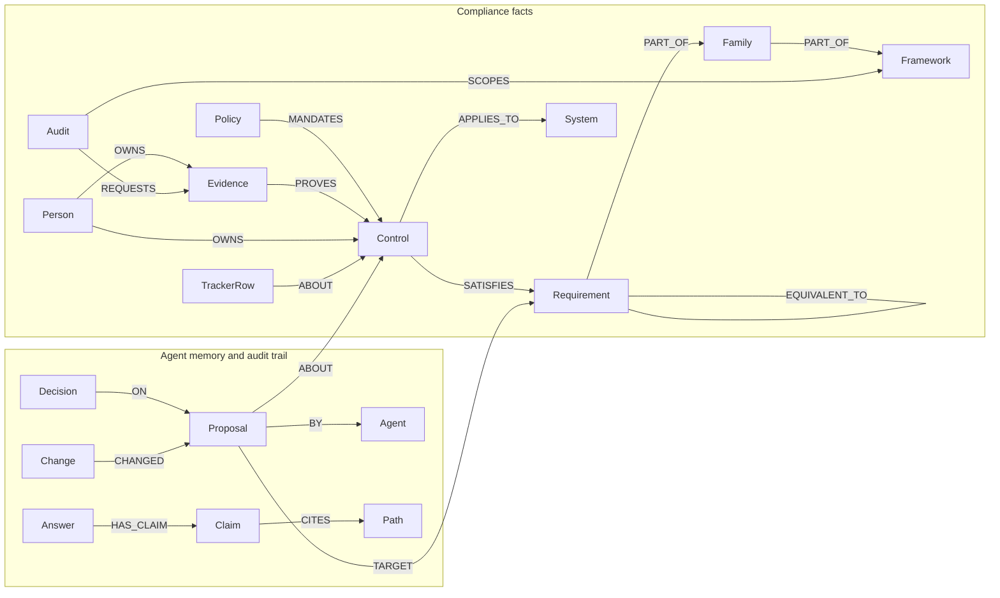

# Details

Reference material moved out of the [README](../README.md): how Crosswalk uses Relate, where the data lives, every command, and a map from the judging criteria to the code.

## Contents

1. [The scenario and its numbers](#the-scenario-and-its-numbers)
2. [How Crosswalk uses Relate](#how-crosswalk-uses-relate)
3. [Relate features used, and where](#relate-features-used-and-where)
4. [Where the data lives](#where-the-data-lives)
5. [All commands](#all-commands)
6. [Inspect the store by hand](#inspect-the-store-by-hand)
7. [Browser explorer](#browser-explorer)
8. [Criteria map](#criteria-map)

## The scenario and its numbers

**Maya Chen is the security lead at Harbor & Pine**, a fictional 85-person B2B software company. A customer requires a **NIST SP 800-171 Rev 3 assessment on 2027-01-15**. Today, in the demo, is 2026-12-02: 44 days out. The company mapped its controls to NIST 800-53 first and tracks everything in a spreadsheet. All numbers come from the committed store.

* **800-171 coverage: 15 of 97 requirements covered directly, 23 more inherited through the NIST crosswalk, 59 gaps.** 39% counting inherited coverage (15% direct only). `crosswalk coverage -f 800-171`.
* **9 requirements lose direct coverage before the audit** because evidence expires (4 fully broken, 5 still met through another framework). The first expiry is 2026-12-18. `crosswalk blast --audit AUD-171`.
* **7 of the evidence items the audit requests are already expired**, 3 more expire before it, 45 are valid. `crosswalk evidence --audit AUD-171 --status lapsed`.
* **5 of the 46 controls the old tracker marks "Compliant" are contradicted by the graph** (four have only expired evidence; CTRL-MCP-13 has no owner in the graph). `crosswalk stale`.
* **Dana Okafor is the sole owner of 6 controls**, all on high-criticality systems. `crosswalk owners`.
* **105 of the 108 valid evidence items serve two or more frameworks.** `crosswalk reuse`.

The planted scenarios behind these numbers are described in [`inputs/company/PLANTED.md`](../inputs/company/PLANTED.md).

## How Crosswalk uses Relate

* **Mode:** directory store with the JSON codec, committed at [`data/crosswalk/`](../data/crosswalk/) (not in-memory, not a single `.rl` file).
* **Why this mode:**
  1. **Readers beside a writer.** The agent surface is Relate's own MCP server, run as `relate serve --mcp stdio --database data/crosswalk --read-only=live`, while the Crosswalk CLI and `crosswalk-mcp` write proposals and decisions. A directory store allows read-only opens beside a live writer, and `--read-only=live` follows the writer's commits without a restart. A single `.rl` file refuses read-only opens while a writer holds it. We measured this on day 1 (Relate 1.2.0, Windows 11): see [`day1/env-setup.md`](day1/env-setup.md).
  2. **Inspectable on GitHub with no install.** `graph.json` is plain JSON, and the build writes a sorted, one-record-per-line export, [`exports/graph.pretty.json`](../exports/graph.pretty.json), so git diffs are readable.
  3. **Small.** 1,971 nodes, 4,375 relationships, 5.93 MB including 384-d embeddings. Rebuilding it from the inputs takes about 2 seconds and produces a byte-identical `graph.json`.
  4. **One writer at a time, measured.** An embedded directory store has a single writer lease, even across threads; a second writer is refused at once with `storage locked`, and our `open_writer` waits for the lease. A **served** store (`relate serve --http`) lets transactions overlap with optimistic commits: the later commit fails with a retryable `write-write conflict`, our code retries, and both writes land. Run `python -m crosswalk.demo_concurrency` to watch both (it prints "lost updates: 0" in each mode).
* **What the graph models:** compliance facts and the agents' working memory in **one graph**. Frameworks contain requirements, and NIST's official crosswalk links requirements across frameworks. The company's controls satisfy requirements, evidence proves controls, controls apply to systems, people own controls and evidence, audits scope frameworks and request evidence. On top of that, agents create proposals and claims that cite paths, and humans record decisions that agents must respect. An agent can therefore ask in one query "has a human already rejected CTRL-AOTP-11 to AC-17, and why?" and get the answer next to the facts.



Full detail (every label with counts and property keys, every relationship type, indexes, path-id format) is in [`schema.md`](schema.md). `TrackerRow` is the company's legacy spreadsheet, imported as facts so the graph can contradict it. `Change`, `Answer`, `Claim` and `Path` are written the first time a human approves a proposal or a checked answer is stored with `--persist`, so they have 0 nodes in the committed store.

## Relate features used, and where

| Relate feature | Where it is used |
|---|---|
| Directory store, JSON codec | `data/crosswalk/`; created by `crosswalk build` (`src/crosswalk/build.py`) |
| Cypher: multi-hop traversal, `UNION ALL` tagged unions, pattern comprehensions, `EXISTS` subqueries, `CALL` subqueries | all of [`queries/`](../queries/) (cookbook: [`queries.md`](queries.md)) |
| Constraints and range indexes | `data/crosswalk/.relate/schema/schema.cypher` |
| Vector index, `SEARCH ... VECTOR INDEX ... WHERE framework = ...` | `queries/q5_suggest_vector.cypher` |
| Full-text index, `SEARCH ... FULLTEXT INDEX` | `queries/q5_suggest_fulltext.cypher` |
| Hybrid search by manual weighted reciprocal-rank fusion (vector and full text in one `CALL`) | `queries/q5_suggest_hybrid.cypher` |
| Transactions: `autocommit = False`, `commit()` bookmarks, rollback, retryable write-write conflicts | `proposals.create_proposal`, `review.decide`, `claims.persist`, `demo_concurrency` |
| Read-only opens (every read command), `--read-only=live` | the CLI, `crosswalk-mcp`; the `relate` MCP server registered by `crosswalk agent setup` |
| MCP server (`relate serve --mcp stdio`, tools `get_schema`, `read_cypher`) | registered by `crosswalk agent setup` next to our own `crosswalk-mcp` |
| `relate serve --http` | the two-agent conflict demo (`python -m crosswalk.demo_concurrency`) |
| WASM (`@relate/relate-wasm` 1.2.0) | the browser explorer in `web/` loads `web/data/graph.cypher` into an in-memory Relate and runs the same Cypher |
| `relate clone`, `relate info`, `relate query --param` | inspecting and copying the store |
| `relate skill install` | optional, `crosswalk agent setup --global-skill` (writes outside the repo) |

Not used: `COMBINE ... USING WRRF` (preview) and quantified path patterns.

## Where the data lives

**The persistent store is [`data/crosswalk/`](../data/crosswalk/)**: a Relate directory store, JSON codec, committed to the repo.

| Path | What it is |
|---|---|
| `data/crosswalk/graph.json` | The whole graph as one line of JSON (5.9 MB). Rewritten at a checkpoint, which `crosswalk build` and `crosswalk review` force on a clean close |
| `data/crosswalk/manifest.json` | `{"codec":"json","checkpoint_lsn":31,...}` |
| `data/crosswalk/wal/` | The write-ahead log. Everything is checkpointed, so it holds no commits |
| `data/crosswalk/.relate/schema/schema.cypher` | Indexes and constraints (vector, full-text, range, unique ids) |
| `data/crosswalk/.cypherlite.lock`, `.cypherlite.writer`, `wal/.cypherlite.lock`, `wal/.cypherlite.writer` | **Must stay.** In Relate 1.2.0 these are static role markers, not runtime locks, and a fresh clone cannot open the store without them (`tests/test_clone.py` checks this) |
| [`exports/graph.pretty.json`](../exports/graph.pretty.json) | Sorted export, one node or relationship per line. Read this one in git diffs |
| `web/data/graph.cypher` | The graph as a Cypher script for the browser (no embeddings, no long text), written by `python -m crosswalk.export_web` |
| `inputs/nist/` | NIST OSCAL catalogs and crosswalk workbooks, unmodified, with source URLs, commit SHA and SHA-256 in [`SOURCES.md`](../inputs/nist/SOURCES.md) |
| `inputs/templates/` | StrongDM comply policy templates, unmodified, with [`NOTICE.md`](../inputs/templates/NOTICE.md), the Apache-2.0 licence and the upstream authors file |
| `inputs/company/` | The fictional Harbor & Pine pack (people, systems, controls, evidence, audits, mappings, seed proposals and decisions, legacy tracker) |
| `inputs/embeddings/` | Cached 384-d embeddings, so a rebuild never needs the model |
| `eval/` | Ground truth, golden questions, bad proposals, hand labels, the agent-run transcripts and the scorecard |
| `queries/` | One `.cypher` file per question |

`out/` (control library dump, ingest warnings, generated packets) is git-ignored.

## All commands

All read commands accept `--json`, and `--store DIR` to point at another store. Tables are wide; use a wide terminal. Real output from the committed store:

| Command | What it answers | Real result |
|---|---|---|
| `crosswalk coverage -f 800-171` (or `800-53`, `CSF`; `--audit AUD-53`; `--detail --status gap`) | Coverage by family, with gaps | `covered 15/97 (15%), inherited 23, gaps 59` |
| `crosswalk adopt 800-171` (or `CSF`) | What we already meet through the NIST crosswalk | `23 of 97 800-171 requirements (24%) are already met through the crosswalk` (CSF: 81 of 106, 76%) |
| `crosswalk blast --days 30` (or `--until 2027-01-15`, `--audit AUD-171`) | What loses coverage if expiring evidence is not renewed | AUD-171: `800-171: 9 lose direct coverage (4 fully broken, 5 still met via another framework); 800-53: 5 lose direct coverage` |
| `crosswalk reuse --top 5` | Evidence that serves the most requirements and frameworks | EV-065: 5 controls, 9 direct requirements across 800-53, 800-171 and CSF, reach 20 with one crosswalk hop |
| `crosswalk owners` | Sole owners and unowned controls | Dana Okafor: 6 sole-owned controls |
| `crosswalk explain 800-171:03.05.03` (`--md`, `--json`) | Why a requirement is covered, inherited or a gap, with dates and proposals | `as of 2026-12-02: gap`; `proposed, not approved: PR-005 CTRL-PWP-4 (pending)` |
| `crosswalk stale` (`--all`) | Where the old spreadsheet says Compliant but the graph disagrees | `5 of 46 'Compliant' rows are contradicted` |
| `crosswalk evidence --audit AUD-171 --status lapsed` | Expired and expiring evidence an audit requests | `7 expired, 3 expiring, 45 valid` |
| `crosswalk suggest CTRL-AOTP-4 --k 5` (`--method fulltext\|vector\|hybrid\|hybrid+graph`) | Candidate requirements for a control. Suggestions only | ranked table of 800-53 requirements |
| `crosswalk propose-map CTRL-AOTP-4 800-53:AC-2 -r "why"` | Write a verified `:Proposal` (never a `SATISFIES`) | `PR-0xx stored as pending ... verified` |
| `crosswalk review --list`, `crosswalk review --approve PR-006 --reason "..."` | Human review; one transaction per decision | `4 pending proposals` |
| `crosswalk decisions` (`--about CTRL-AOTP-11`) | Earlier approvals and rejections with reasons | 4 decisions |
| `crosswalk check eval/agent-runs/live-catch-recorded.json` | Re-run every path an answer cites; exit code 1 if any claim is not a check mark | `0/2 claims verified (1 partial, 1 failed)` |
| `crosswalk packet AUD-171` | Auditor packet (Markdown, no AI), written to `out/packets/` | `AUD-171: 97 requirements; today ✔ 15 ⚠ 23 ✖ 59; on 2027-01-15 ✔ 6 ⚠ 28 ✖ 63` |
| `crosswalk scorecard` (`--quick`) | Recompute every KPI; rewrites `eval/scorecard.json` and `.md` | `pass 24, miss 0, info 18` |
| `crosswalk demo live-catch` | The live catch, replayed | see the README |
| `crosswalk build` | Rebuild `data/crosswalk/` and `exports/graph.pretty.json` from `inputs/` (needs the `relate` CLI) | `built ... (1.8s, 5.93 MB)` |

`propose-map`, `review` and `build` write. To try them without touching the committed store, work on a copy and pass `--store`:

```powershell
Copy-Item -Recurse data\crosswalk $env:TEMP\xw
crosswalk propose-map CTRL-AOTP-4 800-53:AC-2 -r "Owner approval of accounts" --store $env:TEMP\xw
crosswalk review --approve PR-006 --reason "Matches the control wording." --store $env:TEMP\xw
```

Two more maintenance commands: `python -m crosswalk.export_web` regenerates `web/data/` and `web/queries/` from the store, and `pytest` runs the 273 tests.

### What `agent setup` does

```powershell
crosswalk agent setup --dry-run     # show the plan, write nothing
crosswalk agent setup               # asks before writing (add --yes to skip the question)
crosswalk agent setup --undo        # remove exactly what setup added
```

It writes only inside the project: a project-scoped `.mcp.json` registering two MCP servers with absolute paths, and the four agent skills copied to `.claude/skills/` (the committed source is `agents/skills/`). The Relate server is read-only (`get_schema`, `read_cypher`). The Crosswalk server has read tools that return path ids (`coverage`, `adopt`, `blast`, `suggest`, `explain`, `owners`, `reuse`, `decisions`, `stale`, `evidence`), `check_claims`, and write tools that create proposals only (`propose_mapping`, `propose_evidence_request`, `propose_status`). It then starts both servers as a self-test. Relate's own agent skill (`relate skill install`) has no project scope and would write outside this repo, so it runs only if you add `--global-skill`. `.mcp.json` is git-ignored because it holds machine-specific absolute paths.

## Inspect the store by hand

```powershell
relate info --database data\crosswalk                    # codec: json, checkpoint LSN, size
relate --database data\crosswalk --read-only=live --mode jsonl "MATCH (c:Control {adopted: true}) RETURN count(c) AS adopted"    # {"adopted":61}
relate clone data\crosswalk $env:TEMP\crosswalk.rl       # copy to a single-file bundle
```

```python
import relate
c = relate.connect("data/crosswalk", read_only=True)      # use read_only=True; a writer would lock the store
print(c.execute("MATCH (r:Requirement {framework: '800-171'}) RETURN count(r) AS n").fetchall())   # [{'n': 97}]
```

More queries, each with its `.cypher` file: [`queries.md`](queries.md).

## Browser explorer

Live: **https://amanpundhir.github.io/crosswalk-relate/** (deployed from `web/` by `.github/workflows/pages.yml`). To run it locally: `python -m http.server -d web 8000`, then open http://localhost:8000.

Static files only: Relate's WebAssembly build and Cytoscape.js are vendored in `web/vendor/`; no build step, no server, no AI. Tabs: Coverage, Head start (adopt), What breaks (blast), Graph, Agent log (proposals, decisions, the live catch), Scorecard, plus an in-memory what-if ("Expire evidence...", "Remove person...", Reset). The page loads `web/data/graph.cypher` (0.62 MB, no embeddings) into an in-memory Relate database, so nothing you do in it changes the store. `node web/check.mjs` loads the same script into the same WASM binary and checks that the browser's totals equal the CLI's and the oracle's (`15 covered, 23 inherited, 59 gaps`).

## Criteria map

Where to find each judging criterion in under a minute.

| Criterion | Feature | Where to see it |
|---|---|---|
| Relate and connected context | Coverage and gaps by multi-hop traversal framework -> requirement -> control -> evidence | `crosswalk coverage -f 800-171`; browser Coverage tab |
| | Inherited coverage through the NIST crosswalk | `crosswalk adopt 800-171`; browser "Head start" tab |
| | Expiry blast radius: evidence -> controls -> requirements -> frameworks -> audits | `crosswalk blast --audit AUD-171`; browser "What breaks" tab |
| | Hybrid candidate search (vector + full text, fused by WRRF, graph re-rank) | `crosswalk suggest CTRL-AOTP-4` |
| | One graph holds facts and agent memory | `crosswalk decisions`, [`schema.md`](schema.md), browser Agent log tab |
| | Claim checker: cited paths re-run against the graph | `crosswalk check <answer.json>`, `crosswalk demo live-catch` |
| | Several agents writing safely | `python -m crosswalk.demo_concurrency` |
| | Agents query the graph directly | `crosswalk agent setup` registers `relate serve --mcp --read-only=live` and `crosswalk-mcp` |
| AI and agent use | Four agent roles | `agents/skills/*/SKILL.md`; recorded transcripts in `eval/agent-runs/` |
| | One-step agent setup (`--dry-run`, `--undo`, self-test) | `crosswalk agent setup` |
| | Proposals verified before human review | `verified`, `verify_reason` on every `:Proposal`; `crosswalk propose-map` |
| | Memory of human decisions | repeat-rejection run in [`evaluation.md`](evaluation.md) |
| | Agent with the graph vs agent with spreadsheets | [`evaluation.md`](evaluation.md), `eval/agent_compare/` |
| Functionality | One command rebuilds the store deterministically | `crosswalk build` |
| | Core works with no API key | everything except the agent runs; `crosswalk scorecard` |
| | Agent loop end to end | question -> cited answer -> check -> proposal -> verify -> human review -> coverage updates |
| | 273 tests pass | `pytest` (about 2.7 minutes on the development machine) |
| Usefulness | A named user and scenario with real numbers | [the scenario](#the-scenario-and-its-numbers) |
| | Auditor-ready output | `crosswalk packet AUD-171` (no AI), `crosswalk explain <req> --md` |
| | Realistic inputs | control wording comes from open-source policy templates; only people, systems and dates are invented |
| Documentation | Schema, query cookbook, scorecard, limits | [`schema.md`](schema.md), [`queries.md`](queries.md), [`../eval/scorecard.md`](../eval/scorecard.md), [`evaluation.md`](evaluation.md) |
| Creativity | The graph is the agent's memory and audit trail, and the claim checker turns "trust me" into a re-runnable path | the live catch in the README |

Not built or not done, stated plainly: no macOS test; the mapper-agent row of the mapping evaluation is not measured. Tested: a Linux cold start on a clean GitHub Actions runner on every push (README commands, the Relate CLI release asset with checksum, `agent setup` self-test, a rebuild, and the full test suite).
