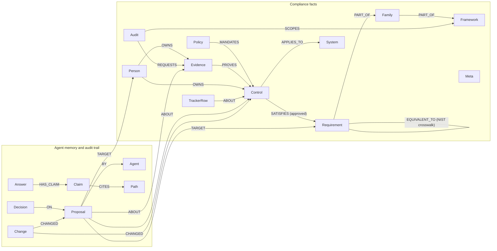

# Graph schema

Everything here was read from the committed store (`data/crosswalk/`, as of 2026-12-02) with read-only Cypher, and from the code that writes to it. The store has **1,971 nodes and 4,375 relationships** (5.93 MB). The company is fictional (Harbor & Pine); the frameworks are NIST's.

Two kinds of data live in the same graph:

* **Compliance facts**: frameworks, requirements, the NIST crosswalk, the company's controls, evidence, people, systems, audits.
* **Agent working memory and audit trail**: proposals, human decisions, changes, answers, claims and the paths they cite.

## Diagram



Reading the diagram: a **requirement** is satisfied by a **control** (only after a human approved the mapping), a control is proved by **evidence**, and evidence expires. Everything an agent says is a **claim** that cites a **path** through these edges; everything an agent wants to change is a **proposal** that a human turns into a **decision**.

`Meta` is a single node with no relationships. It holds the demo date (`as_of`), so no query ever reads the system clock.

## Node labels

Counts are in the committed store. A label marked *created at run time* has no nodes yet in the committed store, because nothing has been approved, checked with `--persist`, or answered into the store; the code that writes it is named.

| Label | Count | Property keys | Notes |
|---|---:|---|---|
| `Framework` | 3 | `id`, `name`, `version` | `800-53`, `800-171`, `CSF` |
| `Family` | 59 | `id`, `title`, `framework` | e.g. `03.05` Identification and Authentication |
| `Requirement` | 1,217 | `id`, `framework`, `title`, `text`, `is_enhancement`, `baselines`, `embedding` | 1,014 from 800-53 Rev 5.2.0 (300 base + 714 enhancements), 97 from 800-171 Rev 3, 106 from CSF 2.0. `embedding` is a 384-d vector. Ids look like `800-53:AC-2(1)`, `800-171:03.01.01`, `CSF:GV.OC-01` |
| `Policy` | 25 | `id`, `name`, `file` | StrongDM comply policy templates (Apache-2.0) |
| `Control` | 430 | `id`, `title`, `text`, `text_sha`, `policy`, `vague`, `context`, `adopted`, `embedding`; adopted controls also `status`, `owners` | 430 controls split out of the templates; **61 are adopted** by Harbor & Pine (`adopted: true`), the other 369 are the library. Ids look like `CTRL-AOTP-4` |
| `Evidence` | 120 | `id`, `kind`, `title`, `collected_at`, `expires_at`, `location` | kinds: report 46, screenshot 23, config-export 20, ticket 17, attestation 14. `expires_at` decides validity |
| `Person` | 15 | `id`, `name`, `team`, `role` | fictional; ids look like `P-maya-chen` |
| `System` | 25 | `id`, `name`, `criticality`, `data_class` | `criticality` is high, med or low |
| `Audit` | 3 | `id`, `name`, `date`, `scope_baseline` (800-53 only) | `AUD-171` 2027-01-15, `AUD-53` 2027-02-20, `AUD-CSF` 2027-03-31 |
| `TrackerRow` | 60 | `id`, `control`, `owner`, `requirements`, `status_text`, `last_reviewed` | one row of the legacy spreadsheet; used to show where the spreadsheet is stale |
| `Meta` | 1 | `id`, `as_of`, `company`, `built_at_source_shas` | the demo date and provenance |
| `Agent` | 1 | `id`, `name` | `mapper-agent` in the committed store; one is merged in for every new proposer |
| `Proposal` | 8 | `id`, `kind`, `status`, `rationale`, `created_at` | `kind` is `map`, `status` or `evidence_request`. `status` is `pending`, `approved` or `rejected`. Proposals written by `crosswalk propose-map` or the MCP `propose_*` tools also carry `verified`, `verify_reason`, `checks` (a JSON string), `crosswalk`, `about_id`, `target_id`; status proposals add `new_status`, `old_status`; evidence requests add `draft`. The 8 seed proposals pre-date the verifier and get `verified` the first time they are reviewed. Written by `src/crosswalk/proposals.py` |
| `Decision` | 4 | `id`, `outcome`, `reason`, `by`, `at` | `outcome` is `approved` or `rejected`. Decisions made by `crosswalk review` also carry `forced` (approved past a failed verification). Written by `src/crosswalk/review.py` |
| `Change` | 0 (*created at run time*) | `id`, `at`, `actor`, `action`, `detail` | the audit-trail row `crosswalk review` writes with every decision. Written by `src/crosswalk/review.py` |
| `Answer` | 0 (*created at run time*) | `id`, `question`, `agent`, `as_of`, `claims`, `verified`, `partial`, `failed`, `summary` | a checked answer stored by `crosswalk check --persist`, `crosswalk packet --persist` or the MCP `check_claims` tool (its `persist` default is true). Written by `claims.persist` |
| `Claim` | 0 (*created at run time*) | `id`, `text`, `verdict`, `verified`, `reason`, `reasons`, `unknown_paths`, `checked_at` | one sentence of an answer with its verdict. Written by `claims.persist` |
| `Path` | 0 (*created at run time*) | `id`, `nodes`, `rels` | a cited path, merged by id, so a later check can re-run it. See "Path ids" below |

## Relationship types

| Type | From to | Count | Properties |
|---|---|---:|---|
| `PART_OF` | `Requirement` to `Family` | 1,217 | none |
| `PART_OF` | `Family` to `Framework` | 59 | none |
| `ENHANCES` | `Requirement` to `Requirement` | 714 | none (800-53 enhancement to its base control) |
| `EQUIVALENT_TO` | `Requirement` to `Requirement` | 1,204 | `kind`, `source`. Symmetric: the stored direction means nothing, queries ignore it. See below |
| `MANDATES` | `Policy` to `Control` | 430 | none |
| `SATISFIES` | `Control` to `Requirement` | 124 | `approved_by`, `approved_at`; edges created by an approval in `crosswalk review` also carry `via_proposal` |
| `PROVES` | `Evidence` to `Control` | 133 | none |
| `APPLIES_TO` | `Control` to `System` | 88 | none |
| `OWNS` | `Person` to `Control` | 60 | none |
| `OWNS` | `Person` to `Evidence` | 120 | none |
| `SCOPES` | `Audit` to `Framework` | 3 | none |
| `REQUESTS` | `Audit` to `Evidence` | 135 | none |
| `ABOUT` | `TrackerRow` to `Control` | 60 | none |
| `ABOUT` | `Proposal` to `Control` (map, status) or `Evidence` (evidence request) | 8 | none |
| `TARGET` | `Proposal` to `Requirement` (map) or `Person` (evidence request) | 8 | none |
| `BY` | `Proposal` to `Agent` | 8 | none |
| `ON` | `Decision` to `Proposal` | 4 | none |
| `CHANGED` | `Change` to `Proposal`, and `Change` to `Control` when a map or status was applied | 0 (*run time*) | none |
| `HAS_CLAIM` | `Answer` to `Claim` | 0 (*run time*) | none |
| `CITES` | `Claim` to `Path` | 0 (*run time*) | `status`, `code`, `reason` |

`EQUIVALENT_TO` breakdown (from the store):

| Between | `source` | `kind` | Count |
|---|---|---|---:|
| 800-171 and 800-53 | `both` (NIST CUI overlay and OSCAL agree) | `derived-from` | 153 |
| 800-171 and 800-53 | `oscal` | `derived-from` | 4 |
| 800-171 and 800-53 | `overlay` | `derived-from` | 1 |
| CSF and 800-171 | `csf2.xlsx` | `informative-reference` | 310 |
| CSF and 800-53 | `csf2.xlsx` | `informative-reference` | 736 |

Total 1,204 (the CSF to 800-171 and CSF to 800-53 rows come from NIST's CSF 2.0 informative-reference workbook, which has no relationship types, so they are all tagged `informative-reference`).

## Indexes and constraints

From `data/crosswalk/.relate/schema/schema.cypher`:

| Kind | Name | On |
|---|---|---|
| Vector (384-d, cosine, `WITH [framework]`) | `requirement_embedding` | `Requirement.embedding` |
| Full-text | `requirement_text_ft` | `Requirement.title`, `Requirement.text` |
| Full-text | `control_text_ft` | `Control.title`, `Control.text` |
| Range | `requirement_framework`, `control_adopted`, `evidence_expires_at` | `Requirement.framework`, `Control.adopted`, `Evidence.expires_at` |
| Unique constraint on `id` | `agent_id`, `audit_id`, `control_id`, `decision_id`, `evidence_id`, `family_id`, `framework_id`, `meta_id`, `person_id`, `policy_id`, `proposal_id`, `requirement_id`, `system_id`, `trackerrow_id` | each label's `id` |

(Relate 1.2.0 scores vectors exactly, by brute force, so the stored HNSW settings are not used for ranking. At about 1,200 requirements this is fast.)

## Rules the data follows

* **Covered**: a requirement is covered when an adopted control has an approved `SATISFIES` to it and at least one `Evidence` that `PROVES` that control has `expires_at` after the demo date.
* **Inherited** (800-171 and CSF only): not covered, but one `EQUIVALENT_TO` hop away is a requirement that is covered.
* **Proposed is not approved**: a `Proposal` never counts as coverage. Only `crosswalk review --approve` creates a `SATISFIES` (the only place `SATISFIES` is written after the build).
* **Time**: every date rule uses `Meta.as_of` (2026-12-02), never the clock.

## Path ids

A path id is a stable, replayable receipt for one fact. Format, from `src/crosswalk/paths.py`:

```
<node> | <rel> | <node> [ | <rel> | <node> ... ]
```

* A node is `Label:id`. The id is the node's `id` property and may contain colons: `Requirement:800-171:03.05.03`, `Control:CTRL-REAP-6`, `Evidence:EV-044`.
* A relationship token is the type as walked from the left node to the right node: `SATISFIES` when walked along the stored direction, `SATISFIES<-` when walked against it. `EQUIVALENT_TO` is symmetric, so it is always the bare token.
* The usual coverage path, read from the requirement:
  `Requirement:800-171:03.05.03|SATISFIES<-|Control:CTRL-REAP-6|PROVES<-|Evidence:EV-044`
* The id is `P-` plus the first 12 hex characters of the SHA-256 of that string (UTF-8), for example `P-94fd053fec24`. It is pure and deterministic: no clock, no store state.
* A path and its reverse have different ids; producers always start from the thing being explained.
* An **absence receipt** proves something is not there. Its last hop is `NO_<TYPE>` (or `NO_<TYPE><-`) and its last node is `Label:*` or a specific node: `Control:CTRL-X|NO_OWNS<-|Person:*` means "this control exists, is adopted, and nobody owns it".

The claim checker (`crosswalk check`, MCP `check_claims`) re-runs each cited path with `queries/check_path.cypher` at the store's date and reports it as `✔` valid, `⚠` partial (for example a mapping that is only proposed) or `✖` failed (for example expired evidence), with the reason.
